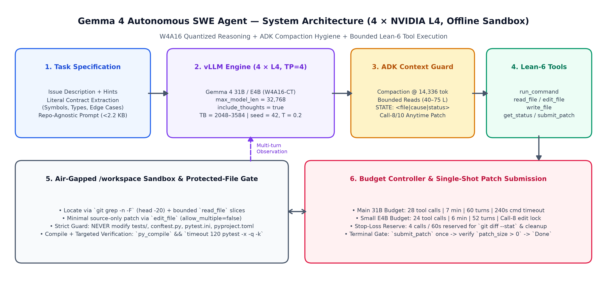
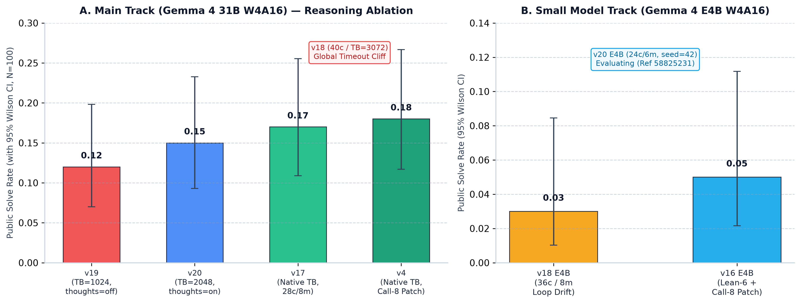

# Gemma 4 Developer Agent: Quantized Reasoning & Context-Efficient Autonomous SWE

**Solo Author:** Robina Mirbahar  
**Competition:** [Google — The Gemma 4 Developer Agent Competition](https://www.kaggle.com/competitions/gemma-4-developer-agent)  
**Companion Paper Repo:** [gemma4-opaque-localization-paper](https://github.com/RobinaMirbahar/gemma4-opaque-localization-paper)  
**License:** Code under Apache-2.0 (`LICENSE`); companion documentation under CC BY 4.0

> **Author & Architect:** [Robina Mirbahar](https://github.com/RobinaMirbahar) (Google Developer Expert in Cloud & AI · Google Cloud Champion Innovator · Co-Author of *AI Engineering*)  
> **Competition & Report:** [Google — The Gemma 4 Developer Agent Competition](https://www.kaggle.com/competitions/gemma-4-developer-agent) · [Technical Report](TECHNICAL_REPORT.md) · [Companion Paper Repo](https://github.com/RobinaMirbahar/gemma4-opaque-localization-paper)  
> **Core Stack:** [Google Gemma 4](https://ai.google.dev/gemma) (`31B` & `E4B` `W4A16-CT`), Google ADK (Lean-6 Tools), vLLM (`TP=4` on `4 × NVIDIA L4`), and Automated Integrity Auditor (`audit_leakage.py`).

[](LICENSE)
[](https://www.python.org/)
[](audit_leakage.py)
[](https://github.com/RobinaMirbahar/gemma4-opaque-localization-paper)
[](https://www.kaggle.com/competitions/gemma-4-developer-agent)

> **Empirical ablation study and reproducible agent architecture** for deploying open-weights, 4-bit quantized (`W4A16`) Gemma 4 reasoning models (`31B` & `E4B`) as autonomous software engineering agents on consumer-grade hardware (`4 × NVIDIA L4`), built for **Google — The Gemma 4 Developer Agent Competition**.

### News & Experiment Log
- **[Nov 24, 2026]** Released `v21_main_31b` (`TB=3584`, `include_thoughts=true`, `seed=42`) and submitted `v20_small_e4b` (Ref `58825231`).
- **[Nov 23, 2026]** `v20_main_31b` (Ref `58759418`) recovered **+0.03** (`0.12 → 0.15`) by restoring `include_thoughts: true` and scaling `thinking_budget` from `1024 → 2048`.
- **[Nov 11, 2026]** Published companion paper figures and study in [gemma4-opaque-localization-paper](https://github.com/RobinaMirbahar/gemma4-opaque-localization-paper).

---

## Abstract

Deploying 4-bit quantized (`W4A16`) reasoning models as autonomous software engineering agents under strict hardware (`4 × NVIDIA L4`, `32,768`-token context ceiling) and ADK history-compaction (`14,336` tokens) constraints exposes three critical failure modes:

1. **Turn-to-Turn Reasoning Amnesia:** Disabling `include_thoughts` and starving `thinking_budget` (`1024`) caused a **-0.06** public-score regression (`0.18 → 0.12`). Restoring `include_thoughts: true` and scaling `thinking_budget` recovered **+0.03** immediately (`v20`, `0.15`), with `v21` (`TB=3584`) isolating near-native reasoning depth.
2. **Global Wall-Clock Timeout Cliff:** Over-allocating tool budgets (`40 calls / 8 min` at `TB=3072`) silently exhausted the global evaluation wall-clock. Bounding budgets to `28c / 7m / 60t` (31B) and `24c / 6m / 52t` (E4B) eliminates timeout failures.
3. **Cross-Repository Generalization:** On finite evaluation benchmarks ($N \in [50, 100]$), small score differences lie within the 95% Wilson confidence interval ($p > 0.35$). Enforcing repo-agnostic prompts, automated leakage checks, and fixed-seed sampling (`seed: 42`) improves out-of-distribution reliability on unseen repositories.

Full statistical analysis and methodology are documented in **[TECHNICAL_REPORT.md](TECHNICAL_REPORT.md)**.

---

## System Architecture



### Hardware, Serving & ADK Configuration

| Component | Main Track (`31B`) | Small Model Track (`E4B`) | Engineering Rationale |
| :--- | :--- | :--- | :--- |
| **Base Model** | `gemma-4-31b-it-qat-w4a16-ct` | `gemma-4-e4b-it-qat-w4a16-ct` | 4-bit QAT weights served offline via vLLM (`TP=4`) |
| **GPU Runtime** | `4 × NVIDIA L4` (96 GB VRAM) | `4 × NVIDIA L4` (96 GB VRAM) | `max_model_len = 32,768`, `gpu_memory_utilization = 0.90` |
| **Reasoning Config** | `include_thoughts: true`, `TB = 2048–3584` | `include_thoughts: true`, `TB = 1536` | Preserves multi-turn CoT while avoiding `v18` timeout cliff |
| **Sampling** | `T = 0.2`, `top_p = 0.95`, `seed = 42` | `T = 0.2`, `top_p = 0.95`, `seed = 42` | Low-variance deterministic patch synthesis |
| **Context Hygiene** | Bounded `read_file` (40–75L) + `STATE:` | Bounded `read_file` (40–60L) + `STATE:` | Prevents premature ADK compaction (`14,336` tokens) |
| **Execution Budget** | `28 calls / 7 min / 60 turns` | `24 calls / 6 min / 52 turns` | Hard stop-loss with 4-call / 60s verification reserve |

---

## Empirical Ablation Results



| Version | Model Track | `include_thoughts` | `thinking_budget` | Budget | Zero-Leakage | Public Score |
| :--- | :--- | :---: | :---: | :---: | :---: | :---: |
| `v4` | `gemma-4-31b-it-qat-w4a16-ct` | `true` | Native | `28c / 8m` | Baseline | **0.18** |
| `v17` | `gemma-4-31b-it-qat-w4a16-ct` | `true` | Native | `28c / 8m` | Contract-First | **0.17** |
| `v18` | `gemma-4-31b-it-qat-w4a16-ct` | `true` | `3072` | `40c / 8m` | Timeout Cliff | *No score* |
| `v19` | `gemma-4-31b-it-qat-w4a16-ct` | `false` | `1024` | `28c / 8m` | Amnesia | `0.12` |
| `v20` | `gemma-4-31b-it-qat-w4a16-ct` | `true` | `2048` | `28c / 7m` | **Verified (`seed=42`)** | **0.15** |
| **`v21`** | `gemma-4-31b-it-qat-w4a16-ct` | **`true`** | **`3584`** | **`28c / 7m`** | **Verified (`seed=42`)** | *Scheduled* |
| `v16` | `gemma-4-e4b-it-qat-w4a16-ct` | `true` | Native | Lean-6 | Baseline | **0.05** |
| `v18` | `gemma-4-e4b-it-qat-w4a16-ct` | `true` | `1536` | `36c / 8m` | Loop Drift | `0.03` |
| **`v20`** | `gemma-4-e4b-it-qat-w4a16-ct` | **`true`** | **`1536`** | **`24c / 6m`** | **Verified (`seed=42`)** | *Evaluating* |

---

## Repository Structure

```text
├── TECHNICAL_REPORT.md      # Full ablation study, Wilson CI shakeup analysis & methodology
├── audit_leakage.py         # Automated zero-leakage, brace-safety & ZIP integrity test suite
├── build_v20.py             # Deterministic builder for v20 (Main 31B & Small E4B)
├── build_v21.py             # Single-variable controlled ablation builder for v21 (Main 31B)
├── v20_main_31b/            # Audited v20 31B bundle & submission.zip
├── v20_small_e4b/           # Audited v20 E4B bundle & submission.zip
├── v21_main_31b/            # Audited v21 31B bundle & submission.zip
├── .github/workflows/       # Continuous Integration leakage & integrity verification
└── LICENSE                  # Apache 2.0 License
```

---

## Reproducibility & Automated Audit

```bash
# 1. Deterministically rebuild and validate bundles
uv run --with pyyaml python build_v20.py
uv run --with pyyaml python build_v21.py

# 2. Run the automated zero-leakage and ZIP integrity test suite
uv run python audit_leakage.py
```

---

## Citation

```bibtex
@misc{mirbahar2026gemma4swe,
  author       = {Robina Mirbahar},
  title        = {Gemma 4 Developer Agent: Quantized Reasoning and Context-Efficient Autonomous Software Engineering},
  year         = {2026},
  howpublished = {\url{https://github.com/RobinaMirbahar/gemma4-dev-agent}}
}
```
